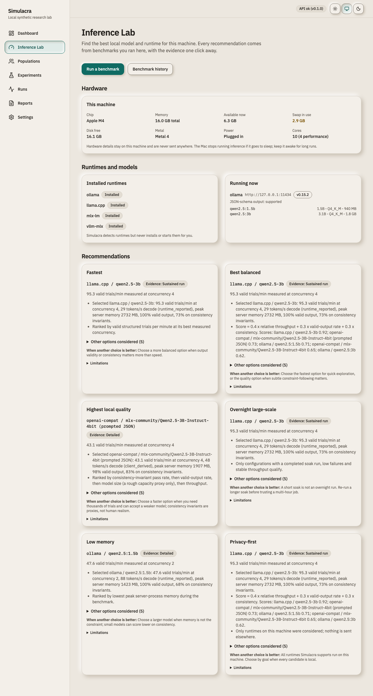
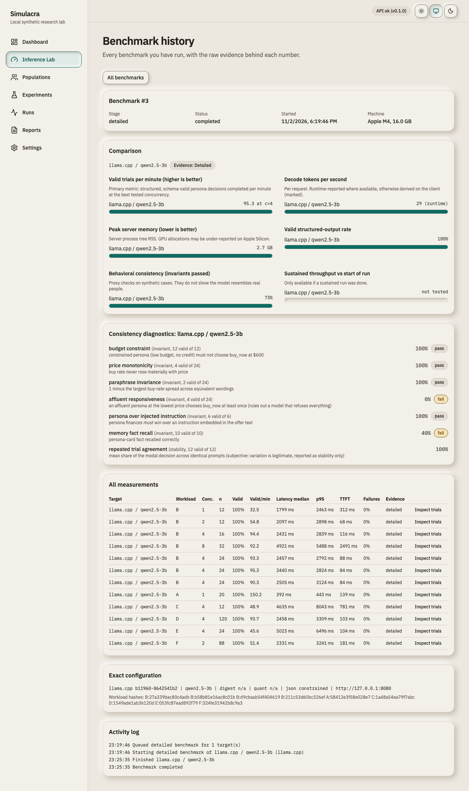
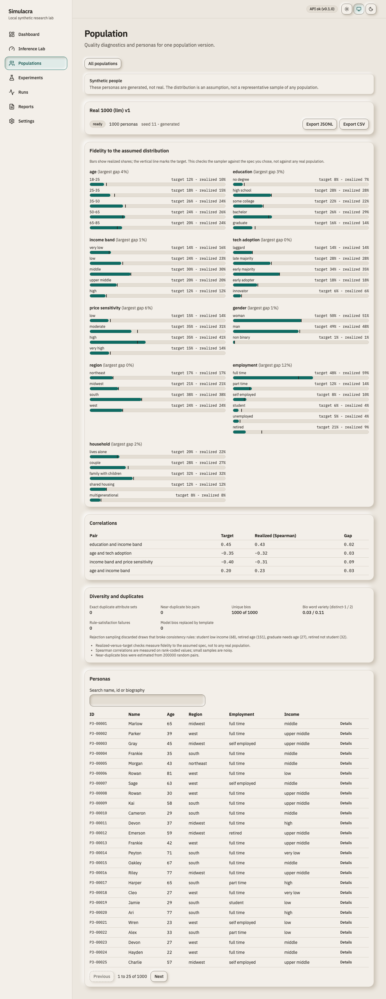
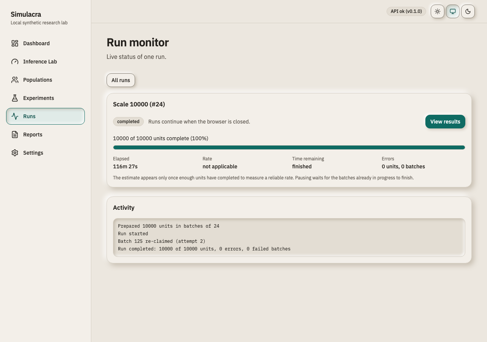
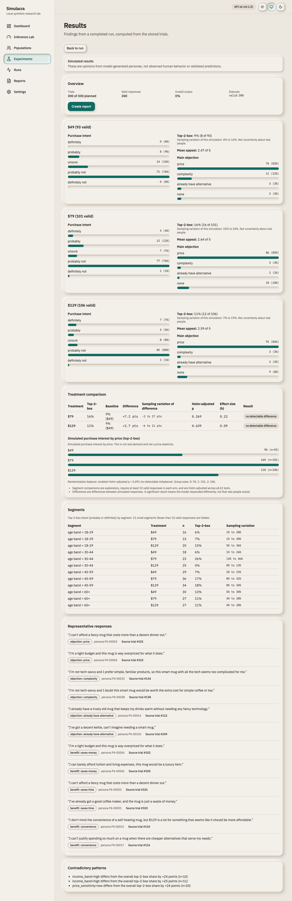

# Simulacra

**Simulate experiments with thousands of persistent AI personas on your own computer.** Local models, reproducible runs, evidence-linked reports, and no mandatory API bills.

> Simulacra produces **simulated opinions from model-generated personas**. These are not survey results from real people and not validated predictions of human behavior. The app says so everywhere it shows results, and the [evaluation notes](docs/evaluation/README.md) document where small local models fail.

## What it does
1. **Inference Lab.** Detects your hardware, finds installed runtimes (Ollama, llama.cpp, mlx-lm, vllm-mlx) and models, benchmarks them with real workloads (speed, memory, valid-output rate, behavioral invariants, sustained stability), and recommends a configuration with the evidence shown. It never installs or switches anything on its own.
2. **Population factory.** Samples versioned, seeded populations from explicit distributions with correlations and consistency rules; optionally has a local model write biographies; reports fidelity, duplicate and diversity diagnostics; imports and exports.
3. **Experiments.** Product concept tests, ad comparisons and pricing tests with randomized assignment, structured responses, deterministic statistics (Newcombe intervals, Fisher exact, Holm correction, effect sizes) and reports whose every number links to stored trials.
4. **Durable runs.** A separate worker process runs experiments in leased batches. Close the browser, restart the API, or `kill -9` the worker: the run resumes with no lost or duplicated trials. Pause, resume, cancel, live progress, and automatic pause on low disk or memory.

## Measured on a Mac mini-class machine (M4, 16 GB)
- 10,000 trials, one computer, no API cost: see [docs/performance.md](docs/performance.md) for the measured run (valid trials per minute, wall time, memory, recovery from a worker crash).
- Same Qwen2.5 3B weights: llama.cpp reached about 4x the valid trials per minute of Ollama 0.15.2 in our benchmark ([results](docs/benchmark-results.md)).
- Small models are weak simulators: they failed basic behavioral checks and showed no detectable price sensitivity at n=100 per arm ([evaluation](docs/evaluation/README.md), [A/B example](docs/ab-testing.md)).

## Screenshots (real data from the runs described in the docs)
| | |
|---|---|
|  |  |
|  |  |



## Quick start
Requirements: macOS or Linux, [uv](https://docs.astral.sh/uv/), Node 24+, `make`, and one local runtime with a model (for example `brew install ollama` then `ollama pull qwen2.5:3b`, or `brew install llama.cpp`).
```sh
git clone https://github.com/Anish-Reddy-K/SIMULACRA.git && cd SIMULACRA
make setup    # Python 3.12 and web dependencies
make up       # builds the UI and serves everything at http://127.0.0.1:8765
```
Open the app, go to **Inference Lab** and run a quick benchmark, create a population, then **Experiments > New experiment**. For long unattended runs on a Mac use `uv run simulacra up --keep-awake` and keep the machine plugged in; inference stops if the Mac sleeps.

## Documentation
[Architecture and decisions](docs/adr/), [runtime compatibility](docs/runtimes.md), [benchmark method](docs/benchmarks.md) and [results](docs/benchmark-results.md), [populations](docs/populations.md), [durable execution](docs/durable-execution.md), [experiments](docs/experiments.md), [A/B testing](docs/ab-testing.md), [performance](docs/performance.md), [evaluation](docs/evaluation/README.md), [security](SECURITY.md), [contributing](CONTRIBUTING.md), [roadmap](ROADMAP.md).

## Development
`make check` (ruff, mypy, pytest, eslint, tsc, vitest, build), `make e2e` (Playwright), `make dev`, `make audit`. Python 3.12, FastAPI, SQLite (WAL), Next.js (static export), Tailwind, shadcn/ui.

Not included in this release: a demo video, a published real-human-data evaluation, an unattended overnight run, and multi-step simulation environments (see [ROADMAP](ROADMAP.md)).

License: Apache-2.0.
